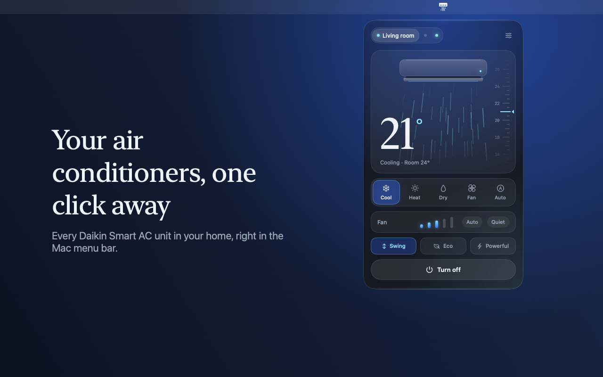

# Aircon for Daikin

Your Daikin air conditioners in the Mac menu bar. Aircon talks to the units set up with the **Daikin Smart AC** app directly over your Wi-Fi: no account, no cloud.

- [Support](support)
- [Privacy policy](privacy)
- [Source code](https://github.com/baldasso/aircon)

Aircon is an independent, open-source app. It is not affiliated with, endorsed by or sponsored by Daikin.

---

# Aircon para Daikin

Seus ares-condicionados Daikin na barra de menus do Mac. O Aircon conversa direto pela sua rede Wi-Fi com os aparelhos configurados no app **Daikin Smart AC**: sem conta, sem nuvem.

- [Suporte](support)
- [Política de privacidade](privacy)
- [Código-fonte](https://github.com/baldasso/aircon)

O Aircon é um app independente e de código aberto, sem vínculo com a Daikin.
